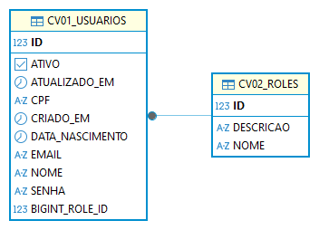
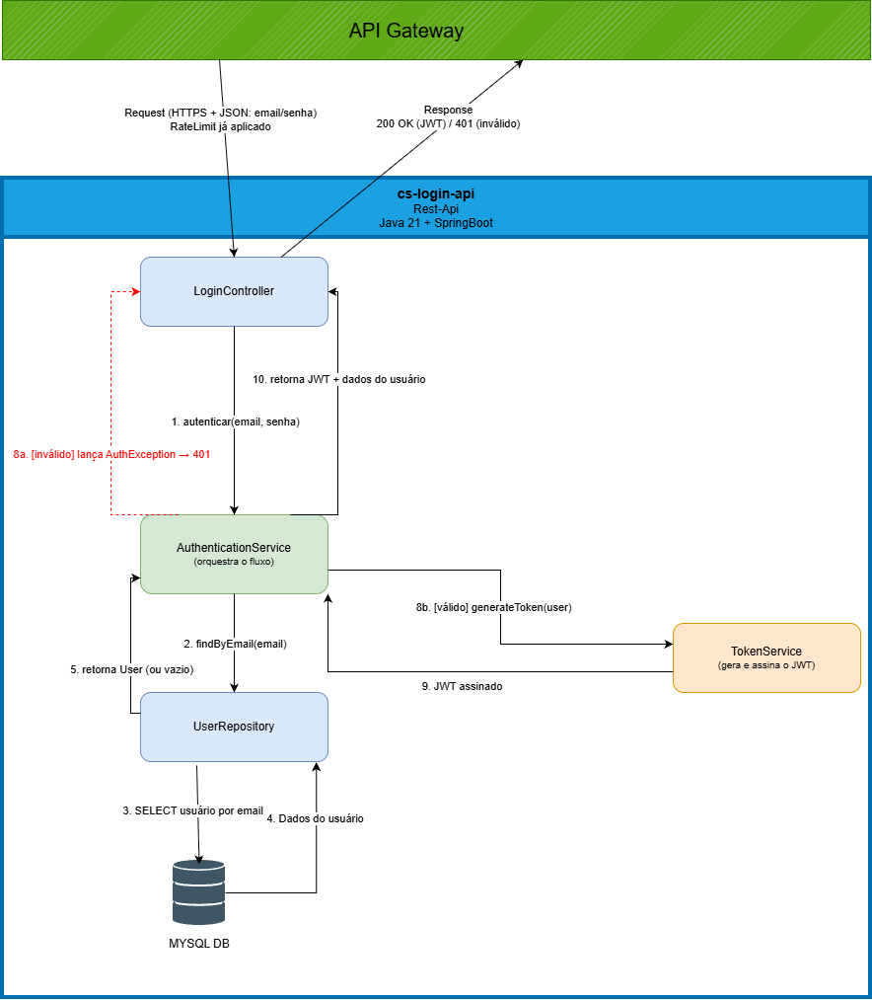

# CV Authentication Service

Microsserviço de **autenticação e gestão de usuários** do ClassVision. Ele autentica usuários, emite tokens **JWT** com os dados e o perfil (role) de cada um, e expõe rotas para o administrador gerenciar contas.

O front-end e os demais microsserviços usam o token emitido aqui para saber **quem é o usuário**, **a qual instituição ele pertence** e **o que ele pode fazer**.

Todo usuário pertence a uma **instituição**, que é cadastrada pelo administrador do sistema.

> Data de referência deste documento: **2026-11-12**.

## Sumário

1. [Visão geral do fluxo](#1-visão-geral-do-fluxo)
2. [Convenções da API](#2-convenções-da-api)
3. [Perfis (roles) e permissões](#3-perfis-roles-e-permissões)
4. [Login](#4-login)
5. [Token JWT: conteúdo e como decodificar](#5-token-jwt-conteúdo-e-como-decodificar)
6. [Instituições](#6-instituições)
7. [Cadastro de usuários](#7-cadastro-de-usuários)
8. [Gestão de usuários](#8-gestão-de-usuários)
9. [Padrão de erros](#9-padrão-de-erros)
10. [Exemplo de fluxo completo (curl)](#10-exemplo-de-fluxo-completo-curl)
11. [Pontos de atenção e limitações conhecidas](#11-pontos-de-atenção-e-limitações-conhecidas)
12. [Como executar localmente](#12-como-executar-localmente)
13. [Configuração e variáveis de ambiente](#13-configuração-e-variáveis-de-ambiente)
14. [Banco de dados](#14-banco-de-dados)
15. [Conteúdo da pasta `docs`](#15-conteúdo-da-pasta-docs)

---

## 1. Visão geral do fluxo

```
┌──────────┐  1. POST /api/auth/login (email, senha)   ┌──────────────────────────┐
│  Front / │ ────────────────────────────────────────▶ │  cv-authentication-      │
│  cliente │ ◀──────────────────────────────────────── │  service                 │
└──────────┘  2. { token: "eyJ..." }                   └──────────────────────────┘
     │
     │ 3. Lê id, nome, email, role e instituicaoId direto do token (tela/menus)
     │
     │ 4. Authorization: Bearer eyJ...
     ▼
┌─────────────────────────┐
│ Demais microsserviços   │  5. Validam a assinatura do token com o mesmo segredo
│ (ou rotas deste serviço)│     e liberam/negam o acesso pela role
└─────────────────────────┘
```

1. O usuário faz login com e-mail e senha.
2. O serviço devolve um **token JWT** assinado (HS512), válido por 1 hora.
3. O front decodifica o token para obter `id`, `nome`, `email`, `role` e `instituicaoId` e controlar o que aparece na tela.
4. Todas as chamadas protegidas enviam o token no cabeçalho `Authorization: Bearer <token>`.
5. Os microsserviços **validam a assinatura** do token, usando o mesmo segredo, antes de confiar nos dados.

**Não existe autocadastro.** Instituições e contas são criadas apenas por um usuário `ADMINISTRADOR`. A ordem é: primeiro cadastra-se a instituição, depois os usuários vinculados a ela.

---

## 2. Convenções da API

| Item | Valor |
|---|---|
| Base URL local | `http://localhost:8080` |
| Prefixo das rotas | `/api` |
| Padrão das rotas | `/api/{recurso}/{acao-recurso}/{id}`, ex.: `/api/instituicoes/cadastrar-instituicao`, `/api/usuarios/buscar-usuario/5` (lista completa na [seção 3](#matriz-de-permissões-deste-serviço)) |
| Formato | JSON (`Content-Type: application/json`) |
| Autenticação | `Authorization: Bearer <token>` |
| Data (`LocalDate`) | `dd/MM/yyyy`, ex.: `25/03/1990` |
| Data e hora nas respostas de usuário | `dd/MM/yyyy HH:mm:ss`, ex.: `12/11/2026 09:30:00` |
| Data e hora nas respostas de erro (`dataHora`) | ISO-8601, ex.: `2026-11-12T10:04:57.1077599` |
| Swagger (fora do perfil `prod`) | `http://localhost:8080/swagger-ui.html` |
| OpenAPI JSON | `http://localhost:8080/v3/api-docs` |

> ⚠️ Datas em formato ISO (`2026-11-12`) **não são aceitas** no corpo das requisições e retornam `400`.

---

## 3. Perfis (roles) e permissões

### Perfis existentes

As roles são criadas automaticamente na primeira inicialização (`DataInitializer`).

| Role | Descrição |
|---|---|
| `ADMINISTRADOR` | Administrador do sistema |
| `PROFESSOR` | Professor da instituição (**role padrão** quando nenhuma é informada) |
| `COORDENADOR` | Coordenador de curso |
| `SECRETARIO` | Secretário da instituição |
| `ASSISTENTE` | Assistente de coordenação |

Os nomes são **sensíveis a maiúsculas/minúsculas**: envie sempre em maiúsculas (`COORDENADOR`, não `coordenador`).

### Matriz de permissões deste serviço

| Método | Rota | Público | ADMINISTRADOR | COORDENADOR | Demais roles |
|---|---|:-:|:-:|:-:|:-:|
| `POST` | `/api/auth/login` | ✅ | ✅ | ✅ | ✅ |
| `POST` | `/api/usuarios/cadastrar-usuario` | ❌ | ✅ | ❌ | ❌ |
| `GET` | `/api/usuarios/listar-usuarios` | ❌ | ✅ | ✅ | ❌ |
| `GET` | `/api/usuarios/buscar-usuario/{id}` | ❌ | ✅ | ✅ | ❌ |
| `GET` | `/api/usuarios/buscar-usuario-por-email/{email}` | ❌ | ✅ | ✅ | ❌ |
| `PUT` | `/api/usuarios/atualizar-usuario/{id}` | ❌ | ✅ | ✅ | ❌ |
| `PATCH` | `/api/usuarios/desativar-usuario/{id}` | ❌ | ✅ | ❌ | ❌ |
| `PATCH` | `/api/usuarios/ativar-usuario/{id}` | ❌ | ✅ | ❌ | ❌ |
| `DELETE` | `/api/usuarios/excluir-usuario/{id}` | ❌ | ✅ | ❌ | ❌ |
| `POST` | `/api/instituicoes/cadastrar-instituicao` | ❌ | ✅ | ❌ | ❌ |
| `GET` | `/api/instituicoes/listar-instituicoes` | ❌ | ✅ | ✅ | ✅ |
| `GET` | `/api/instituicoes/buscar-instituicao/{id}` | ❌ | ✅ | ✅ | ✅ |
| `PUT` | `/api/instituicoes/atualizar-instituicao/{id}` | ❌ | ✅ | ❌ | ❌ |
| `PATCH` | `/api/instituicoes/ativar-instituicao/{id}` | ❌ | ✅ | ❌ | ❌ |
| `PATCH` | `/api/instituicoes/desativar-instituicao/{id}` | ❌ | ✅ | ❌ | ❌ |

- Sem token, ou com token inválido/expirado: **`401 Unauthorized`**.
- Com token válido, mas role sem permissão: **`403 Forbidden`**.

### Usuário administrador padrão

Se ainda não existir, o serviço cria na inicialização o administrador e a instituição padrão à qual ele pertence:

| E-mail | Senha | Instituição |
|---|---|---|
| `admin@classvision.com` | `admin123456` | `ClassVision` (CNPJ provisório `00000000000000`) |

> 🔒 **Troque essa senha em qualquer ambiente que não seja local.**
>
> O CNPJ `00000000000000` da instituição padrão é provisório e **não passa na validação de CNPJ**. Para editar essa instituição via `PUT`, informe o CNPJ real. Depois da troca, nenhuma nova instituição padrão é criada nas próximas inicializações.

---

## 4. Login

`POST /api/auth/login` (público)

### Requisição

```json
{
  "email": "admin@classvision.com",
  "senha": "admin123456"
}
```

| Campo | Tipo | Obrigatório | Regras |
|---|---|:-:|---|
| `email` | string | ✅ | Não pode ser vazio; deve ser um e-mail válido |
| `senha` | string | ✅ | Não pode ser vazia |

### Resposta de sucesso: `200 OK`

```json
{
  "token": "eyJhbGciOiJIUzUxMiJ9.eyJpZCI6MSwibm9tZSI6...",
  "tipo": "Bearer",
  "expiresIn": 3600000
}
```

| Campo | Descrição |
|---|---|
| `token` | JWT a ser enviado nas próximas requisições |
| `tipo` | Sempre `Bearer`: use `Authorization: Bearer <token>` |
| `expiresIn` | Validade do token **em milissegundos** (`3600000` = 1 hora) |

A resposta traz **apenas o token**. Os dados do usuário (`id`, `nome`, `email`, `role`, `instituicaoId`) ficam **dentro do token** (veja a [seção 5](#5-token-jwt-conteúdo-e-como-decodificar)).

### Regras

- O e-mail é o identificador de login.
- Usuários **desativados** (`ativo = false`) não conseguem fazer login.
- Por segurança, e-mail inexistente, senha errada e usuário desativado retornam **a mesma mensagem**: o cliente não sabe qual dos três aconteceu.
- Não existe refresh token: quando o token expira, é preciso fazer login novamente.

### Erros

| Status | Quando | `descricao` |
|---|---|---|
| `400` | E-mail vazio/inválido ou senha vazia | Ex.: `O campo 'senha' não pode estar em branco.` |
| `400` | JSON malformado | `Corpo da requisicao invalido ou com campo em formato incorreto.` |
| `401` | Credenciais inválidas ou usuário desativado | `Email ou senha inválidos.` |

---

## 5. Token JWT: conteúdo e como decodificar

### Estrutura

Um JWT tem três partes separadas por ponto: `HEADER.PAYLOAD.ASSINATURA`.

- **Header:** `{"alg":"HS512"}`
- **Payload** (os dados):

```json
{
  "id": 1,
  "nome": "Administrador",
  "email": "admin@classvision.com",
  "role": "ADMINISTRADOR",
  "instituicaoId": 1,
  "roles": ["ROLE_ADMINISTRADOR"],
  "sub": "admin@classvision.com",
  "iat": 1794488290,
  "exp": 1794491890
}
```

| Claim | Tipo | Descrição | Uso recomendado |
|---|---|---|---|
| `id` | número | ID do usuário no banco | Identificar o usuário em outros serviços (chave estrangeira, auditoria) |
| `nome` | string | Nome do usuário | Exibir na interface |
| `email` | string | E-mail do usuário | Exibir / contato |
| `role` | string | Role **sem prefixo** (`ADMINISTRADOR`, `PROFESSOR`...) | Comparação direta no front e nos microsserviços |
| `instituicaoId` | número | ID da instituição do usuário | **Filtrar os dados pela instituição** nos microsserviços (um usuário só deve ver dados da própria instituição) |
| `roles` | lista de strings | Role **com prefixo** `ROLE_` | Formato esperado pelo Spring Security (`hasRole(...)`) |
| `sub` | string | *Subject*: e-mail do usuário | Padrão JWT; usado por este serviço para localizar o usuário |
| `iat` | número | Emitido em (Unix timestamp **em segundos**) | Informativo |
| `exp` | número | Expira em (Unix timestamp **em segundos**) | Verificar se o token ainda é válido |

### ⚠️ O token é legível, mas não é alterável

O payload do JWT é apenas codificado em **Base64URL, não é criptografado**. Qualquer pessoa com o token consegue ler o conteúdo (por exemplo, colando em [jwt.io](https://jwt.io)). Por isso:

- O token **nunca** carrega senha, CPF, data de nascimento ou outros dados sensíveis.
- A **assinatura** garante que ninguém consegue **alterar** os dados sem invalidar o token.
- Em produção, use sempre **HTTPS**. É ele que protege o token na rede.

### Decodificar vs. validar

| | Decodificar | Validar |
|---|---|---|
| O que faz | Só lê o payload | Confere a assinatura com o segredo e checa a expiração |
| Precisa do segredo? | Não | Sim (`JWT_SECRET`) |
| Onde usar | **Front-end**, só para montar a interface (nome, menus por role) | **Back-end / microsserviços**, sempre, antes de liberar qualquer dado ou ação |

> O front **nunca** recebe o segredo. Esconder um botão pela role melhora a experiência do usuário, mas a **segurança de verdade** fica no back-end, que valida o token em toda requisição.

### Front-end (JavaScript/TypeScript): decodificar

Sem bibliotecas, com suporte a acentos (UTF-8):

```js
function decodificarToken(token) {
  const payloadBase64Url = token.split('.')[1];
  const base64 = payloadBase64Url.replace(/-/g, '+').replace(/_/g, '/');
  const bytes = Uint8Array.from(atob(base64), (c) => c.charCodeAt(0));
  return JSON.parse(new TextDecoder().decode(bytes));
}

function tokenExpirado(token) {
  const { exp } = decodificarToken(token);
  return exp * 1000 <= Date.now(); // exp vem em segundos
}

// Uso
const { token } = await (await fetch('http://localhost:8080/api/auth/login', {
  method: 'POST',
  headers: { 'Content-Type': 'application/json' },
  body: JSON.stringify({ email, senha }),
})).json();

const usuario = decodificarToken(token);
// usuario.id, usuario.nome, usuario.email, usuario.role, usuario.instituicaoId

if (usuario.role === 'ADMINISTRADOR') {
  // exibir menu de administração
}
```

Alternativa com biblioteca: [`jwt-decode`](https://www.npmjs.com/package/jwt-decode) (`import { jwtDecode } from 'jwt-decode'; jwtDecode(token)`).

Enviando o token nas requisições:

```js
fetch('http://localhost:8080/api/usuarios/listar-usuarios', {
  headers: { Authorization: `Bearer ${token}` },
});
```

Boas práticas no front:
- Antes de chamar a API, verifique `tokenExpirado(token)`. Se expirou, redirecione para o login.
- Trate `401` como "sessão expirada/inválida" (volte para o login) e `403` como "sem permissão".
- Prefira guardar o token em memória ou `sessionStorage`. `localStorage` fica exposto em caso de XSS.

### Microsserviço Java com Spring Security (recomendado)

Dependência: no Spring Boot 4, `spring-boot-starter-security-oauth2-resource-server`; no Spring Boot 3, `spring-boot-starter-oauth2-resource-server`.

```java
@Configuration
@EnableWebSecurity
@EnableMethodSecurity
public class SecurityConfig {

    @Bean
    JwtDecoder jwtDecoder(@Value("${jwt.secret}") String secret) {
        SecretKey key = new SecretKeySpec(secret.getBytes(StandardCharsets.UTF_8), "HmacSHA512");
        return NimbusJwtDecoder.withSecretKey(key).macAlgorithm(MacAlgorithm.HS512).build();
    }

    @Bean
    JwtAuthenticationConverter jwtAuthenticationConverter() {
        // Usa a claim "roles" (já com prefixo ROLE_) como authorities
        JwtGrantedAuthoritiesConverter authorities = new JwtGrantedAuthoritiesConverter();
        authorities.setAuthoritiesClaimName("roles");
        authorities.setAuthorityPrefix("");

        JwtAuthenticationConverter converter = new JwtAuthenticationConverter();
        converter.setJwtGrantedAuthoritiesConverter(authorities);
        return converter;
    }

    @Bean
    SecurityFilterChain filterChain(HttpSecurity http) throws Exception {
        http
            .csrf(AbstractHttpConfigurer::disable)
            .sessionManagement(s -> s.sessionCreationPolicy(SessionCreationPolicy.STATELESS))
            .authorizeHttpRequests(auth -> auth
                .requestMatchers("/api/admin/**").hasRole("ADMINISTRADOR")
                .anyRequest().authenticated())
            .oauth2ResourceServer(oauth -> oauth.jwt(Customizer.withDefaults()));
        return http.build();
    }
}
```

Lendo os dados do usuário no controller:

```java
@GetMapping("/minhas-turmas")
@PreAuthorize("hasAnyRole('PROFESSOR', 'COORDENADOR')")
public List<TurmaDTO> minhasTurmas(@AuthenticationPrincipal Jwt jwt) {
    Long usuarioId = ((Number) jwt.getClaim("id")).longValue();
    Long instituicaoId = ((Number) jwt.getClaim("instituicaoId")).longValue();
    String nome = jwt.getClaimAsString("nome");
    String role = jwt.getClaimAsString("role");
    // Sempre filtre pela instituição do token, nunca por um parâmetro enviado pelo cliente
    return turmaService.listarPorProfessor(instituicaoId, usuarioId);
}
```

### Microsserviço Java sem Spring Security (biblioteca jjwt 0.12+)

```java
SecretKey key = Keys.hmacShaKeyFor(secret.getBytes(StandardCharsets.UTF_8));

Claims claims = Jwts.parser()
        .verifyWith(key)
        .build()
        .parseSignedClaims(token)   // lança exceção se a assinatura for inválida ou o token estiver expirado
        .getPayload();

Long id = ((Number) claims.get("id")).longValue();
Long instituicaoId = ((Number) claims.get("instituicaoId")).longValue();
String nome = claims.get("nome", String.class);
String role = claims.get("role", String.class);
```

### Microsserviço Node.js (biblioteca `jsonwebtoken`)

```js
const jwt = require('jsonwebtoken');

function autenticar(req, res, next) {
  const [, token] = (req.headers.authorization || '').split(' ');
  try {
    req.usuario = jwt.verify(token, process.env.JWT_SECRET, { algorithms: ['HS512'] });
    next();
  } catch {
    res.status(401).json({ descricao: 'Token inválido ou expirado.' });
  }
}

const exigirRole = (...roles) => (req, res, next) =>
  roles.includes(req.usuario.role) ? next() : res.status(403).json({ descricao: 'Acesso negado.' });

app.get('/api/relatorios', autenticar, exigirRole('ADMINISTRADOR', 'COORDENADOR'), handler);
```

### Requisitos do segredo (`JWT_SECRET`)

- Todos os serviços que validam o token precisam do **mesmo** valor de `jwt.secret` usado aqui.
- Use um segredo com **no mínimo 64 caracteres**. A biblioteca escolhe o algoritmo pelo tamanho da chave (≥ 64 bytes → HS512). Um segredo menor muda o algoritmo para HS384 ou HS256 e quebra os serviços configurados para HS512.
- Nunca coloque o segredo no código do front-end nem em repositórios.

---

## 6. Instituições

Cada usuário pertence a **uma** instituição. As instituições são cadastradas e mantidas apenas pelo `ADMINISTRADOR`. Qualquer usuário autenticado pode consultá-las (por exemplo, para o front exibir o nome da instituição do usuário logado).

### Campos

| Campo | Tipo | Descrição |
|---|---|---|
| `id` | número | Identificador (gerado pelo servidor) |
| `nome` | string | Nome da instituição |
| `cnpj` | string | 14 caracteres, **sem pontuação**. Aceita o CNPJ **numérico** e o novo **alfanumérico** (em vigor desde julho/2026). **Único** no sistema |
| `telefone` | string | DDD + número, **somente dígitos** (10 ou 11 dígitos) |
| `situacao` | string | `ATIVA` ou `INATIVA` |
| `criadoEm` / `atualizadoEm` | string | `dd/MM/yyyy HH:mm:ss`, preenchidos pelo servidor |

### Cadastrar: `POST /api/instituicoes/cadastrar-instituicao`

**Permissão:** `ADMINISTRADOR`.

```json
{
  "nome": "Instituto Federal Goiano - Campus Urutaí",
  "cnpj": "10.651.417/0005-00",
  "telefone": "(64) 3465-1900"
}
```

| Campo | Obrigatório | Regras |
|---|:-:|---|
| `nome` | ✅ | Não pode ser vazio |
| `cnpj` | ✅ | CNPJ válido (dígitos verificadores conferidos), com ou sem pontuação. Letras são convertidas para maiúsculas. |
| `telefone` | ✅ | DDD + número, com ou sem máscara: `(64) 3465-1900`, `64 99999-8888`, `6434651900` |

- O servidor **remove a pontuação** do CNPJ e a máscara do telefone antes de salvar. A verificação de CNPJ duplicado já usa o valor normalizado, então `10.651.417/0005-00` e `10651417000500` são tratados como o mesmo CNPJ.
- Toda instituição nasce `ATIVA`. A `situacao` não é enviada no corpo: ela só muda pelas rotas de ativar/desativar.

Resposta: `201 Created`

```json
{
  "id": 2,
  "nome": "Instituto Federal Goiano - Campus Urutaí",
  "cnpj": "10651417000500",
  "telefone": "6434651900",
  "situacao": "ATIVA",
  "criadoEm": "12/11/2026 10:43:28",
  "atualizadoEm": "12/11/2026 10:43:28"
}
```

### Listar: `GET /api/instituicoes/listar-instituicoes`

**Permissão:** qualquer usuário autenticado. Retorna `200` com todas as instituições (ativas e inativas). Não há paginação.

### Buscar por ID: `GET /api/instituicoes/buscar-instituicao/{id}`

**Permissão:** qualquer usuário autenticado. `200`, ou `404` (`Instituição não encontrada com ID: 99`).

### Atualizar: `PUT /api/instituicoes/atualizar-instituicao/{id}`

**Permissão:** `ADMINISTRADOR`. Mesmo corpo e mesmas validações do cadastro (`nome`, `cnpj` e `telefone` obrigatórios). A `situacao` não é alterada por aqui. Respostas: `200`, `400`, `404` ou `409`.

### Ativar / desativar: `PATCH /api/instituicoes/ativar-instituicao/{id}` e `PATCH /api/instituicoes/desativar-instituicao/{id}`

**Permissão:** `ADMINISTRADOR`. Altera a `situacao` para `ATIVA` ou `INATIVA`. Retorna `200` com a instituição.

Efeitos de uma instituição **`INATIVA`**:
- Novos usuários **não podem** ser cadastrados nela, e usuários **não podem ser transferidos** para ela (`400`).
- Usuários que **já pertencem** a ela continuam podendo fazer login e ser editados, mantendo a instituição atual.

> Não existe exclusão de instituição: use a desativação. Excluir quebraria o vínculo dos usuários e os dados dos outros microsserviços.

### Erros

| Status | Quando | Exemplo de `descricao` |
|---|---|---|
| `400` | Campo vazio | `O campo 'nome' não pode estar em branco.` |
| `400` | CNPJ inválido | `O campo 'cnpj' deve ser um CNPJ válido.` |
| `400` | Telefone fora do formato | `O campo 'telefone' deve conter DDD + número, ex.: (64) 3465-1900 ou 64999998888.` |
| `403` | Escrita por usuário que não é `ADMINISTRADOR` | `Acesso negado para este recurso.` |
| `404` | Instituição inexistente | `Instituição não encontrada com ID: 99` |
| `409` | CNPJ já cadastrado | `CNPJ já existente na base de dados.` |

---

## 7. Cadastro de usuários

`POST /api/usuarios/cadastrar-usuario` (**somente `ADMINISTRADOR`**)

### Requisição

```http
POST /api/usuarios/cadastrar-usuario
Authorization: Bearer <token-do-administrador>
Content-Type: application/json
```

```json
{
  "nome": "Maria Souza",
  "cpf": "52998224725",
  "email": "maria.souza@classvision.com",
  "senha": "senhaForte123",
  "dataNascimento": "25/03/1990",
  "role": "COORDENADOR",
  "instituicaoId": 2
}
```

| Campo | Tipo | Obrigatório | Regras |
|---|---|:-:|---|
| `nome` | string | ✅ | Não pode ser vazio |
| `cpf` | string | ✅ | CPF **válido** (dígitos verificadores conferidos); **único** no sistema |
| `email` | string | ✅ | E-mail válido; **único** no sistema; será o login |
| `senha` | string | ✅ | Não pode ser vazia; armazenada com hash **BCrypt** (nunca é retornada) |
| `dataNascimento` | string | ❌ | Formato `dd/MM/yyyy` |
| `role` | string | ❌ | Uma das roles da [seção 3](#perfis-existentes), em maiúsculas. Se omitida → `PROFESSOR` |
| `instituicaoId` | número | ✅ | ID de uma instituição **existente** e **`ATIVA`** ([seção 6](#6-instituições)) |

### Regras de negócio

- Apenas `ADMINISTRADOR` cadastra usuários. Não há autocadastro.
- Todo usuário precisa de uma instituição. Cadastre a instituição antes ([seção 6](#6-instituições)).
- E-mail e CPF não podem se repetir. A verificação é feita antes de salvar e retorna `409`.
- **Envie o CPF só com números** (`52998224725`). O formato com pontuação (`529.982.247-25`) também é aceito, mas é gravado como foi enviado, e a verificação de duplicidade compara o texto exato. O mesmo CPF em formatos diferentes passaria como dois CPFs distintos.
- Todo usuário nasce **ativo** (`ativo = true`).
- `criadoEm` e `atualizadoEm` são preenchidos automaticamente pelo servidor.
- A resposta de validação traz **um erro por vez** (o primeiro campo inválido encontrado).

### Resposta de sucesso: `201 Created`

```json
{
  "id": 2,
  "nome": "Maria Souza",
  "email": "maria.souza@classvision.com",
  "cpf": "52998224725",
  "dataNascimento": "25/03/1990",
  "role": "COORDENADOR",
  "instituicaoId": 2,
  "instituicaoNome": "Instituto Federal Goiano - Campus Urutaí",
  "criadoEm": "12/11/2026 10:04:57",
  "atualizadoEm": "12/11/2026 10:04:57",
  "ativo": true
}
```

O cadastro **não** faz login automático: o novo usuário deve chamar `/api/auth/login`.

### Erros

| Status | Quando | Exemplo de `descricao` |
|---|---|---|
| `400` | Campo obrigatório ausente/vazio | `O campo 'nome' não pode estar em branco.` |
| `400` | CPF inválido | `número do registro de contribuinte individual brasileiro (CPF) inválido` |
| `400` | E-mail com formato inválido | `O campo 'email' deve ser um endereço de e-mail válido.` |
| `400` | Data fora de `dd/MM/yyyy` ou JSON malformado | `Corpo da requisicao invalido ou com campo em formato incorreto.` |
| `400` | `instituicaoId` ausente | `O campo 'instituicaoId' é obrigatório.` |
| `400` | Instituição `INATIVA` | `A instituição informada está inativa e não pode receber usuários.` |
| `401` | Sem token / token inválido ou expirado | `Acesso nao autorizado.` |
| `403` | Token de usuário que não é `ADMINISTRADOR` | `Acesso negado para este recurso.` |
| `404` | Role inexistente (ou em minúsculas) | `Role não encontrada: coordenador` |
| `404` | Instituição inexistente | `Instituição não encontrada com ID: 99` |
| `409` | E-mail já cadastrado | `Email já existente na base de dados.` |
| `409` | CPF já cadastrado | `CPF já existente na base de dados.` |

---

## 8. Gestão de usuários

Todas as rotas exigem `Authorization: Bearer <token>`. Os objetos de usuário retornados seguem o formato da [resposta de cadastro](#resposta-de-sucesso-201-created) (incluindo `instituicaoId` e `instituicaoNome`).

### Listar todos: `GET /api/usuarios/listar-usuarios`

**Permissão:** `ADMINISTRADOR`, `COORDENADOR`. Retorna `200` com um array de usuários, incluindo os inativos. Não há paginação.

### Buscar por ID: `GET /api/usuarios/buscar-usuario/{id}`

**Permissão:** `ADMINISTRADOR`, `COORDENADOR`. `200` com o usuário, ou `404` (`Usuário não encontrado com ID: 99`).

### Buscar por e-mail: `GET /api/usuarios/buscar-usuario-por-email/{email}`

**Permissão:** `ADMINISTRADOR`, `COORDENADOR`. Ex.: `GET /api/usuarios/buscar-usuario-por-email/maria.souza@classvision.com`. `200` ou `404`.

### Atualizar: `PUT /api/usuarios/atualizar-usuario/{id}`

**Permissão:** `ADMINISTRADOR`, `COORDENADOR`.

O corpo é **o mesmo do cadastro**, e a atualização é **completa** (não parcial):

- `nome`, `cpf`, `email` e `senha` são **obrigatórios**, com as mesmas validações do cadastro.
- A **senha é sempre substituída** pelo valor enviado. Para manter a senha atual, é preciso reenviá-la.
- `dataNascimento` é sobrescrita: se for omitida, fica vazia.
- `role` é opcional: se omitida ou vazia, **mantém** a role atual.
- `instituicaoId` é **obrigatório**. Enviar o mesmo ID mantém a instituição, mesmo que ela esteja `INATIVA`. Trocar para outra instituição exige que a nova esteja `ATIVA`.
- E-mail e CPF continuam únicos (`409` se pertencerem a outro usuário).

Respostas: `200` com o usuário atualizado, `400`, `404` ou `409`.

> Se o **e-mail** de um usuário for alterado, os tokens já emitidos para ele deixam de funcionar (`401`), porque o `sub` do token aponta para o e-mail antigo. Ele precisa fazer login novamente.

### Desativar: `PATCH /api/usuarios/desativar-usuario/{id}`

**Permissão:** `ADMINISTRADOR`. Marca `ativo = false` (*soft delete*): o registro continua no banco e o usuário **não consegue mais fazer login**. Retorna `200` com o usuário.

### Ativar: `PATCH /api/usuarios/ativar-usuario/{id}`

**Permissão:** `ADMINISTRADOR`. Marca `ativo = true`. Retorna `200` com o usuário.

### Excluir: `DELETE /api/usuarios/excluir-usuario/{id}`

**Permissão:** `ADMINISTRADOR`. Remove o registro **definitivamente** do banco. Retorna `204 No Content`, ou `404`.

> Prefira **desativar** a excluir: outros microsserviços podem guardar o `id` do usuário (turmas, registros, auditoria).

---

## 9. Padrão de erros

Todas as respostas de erro seguem o mesmo formato:

```json
{
  "descricao": "Email já existente na base de dados.",
  "statusCode": 409,
  "solucao": "Use outro valor para os dados unicos (como email ou CPF).",
  "dataHora": "2026-11-12T10:14:11.7330021"
}
```

| Campo | Descrição |
|---|---|
| `descricao` | O que aconteceu (pode ser exibido ao usuário) |
| `statusCode` | Código HTTP (igual ao status da resposta) |
| `solucao` | Sugestão de como resolver |
| `dataHora` | Momento do erro (ISO-8601) |

| Status | Significado |
|---|---|
| `400 Bad Request` | Dados inválidos, campo obrigatório ausente, JSON malformado, data em formato errado, instituição inativa |
| `401 Unauthorized` | Credenciais inválidas no login, ou token ausente/inválido/expirado nas rotas protegidas |
| `403 Forbidden` | Token válido, mas a role não tem permissão para a rota |
| `404 Not Found` | Usuário, instituição, role ou rota não encontrados |
| `409 Conflict` | E-mail, CPF ou CNPJ já cadastrados |
| `500 Internal Server Error` | Erro inesperado no servidor |

> Requisições sem token para rotas inexistentes retornam `401` (e não `404`), porque toda rota que não é pública exige autenticação.

---

## 10. Exemplo de fluxo completo (curl)

```bash
BASE=http://localhost:8080

# 1. Login do administrador
TOKEN=$(curl -s -X POST $BASE/api/auth/login \
  -H 'Content-Type: application/json' \
  -d '{"email":"admin@classvision.com","senha":"admin123456"}' \
  | sed -E 's/.*"token":"([^"]+)".*/\1/')

# 2. Cadastrar uma instituição (anote o "id" retornado)
curl -X POST $BASE/api/instituicoes/cadastrar-instituicao \
  -H "Authorization: Bearer $TOKEN" \
  -H 'Content-Type: application/json' \
  -d '{"nome":"Instituto Federal Goiano - Campus Urutaí","cnpj":"10651417000500","telefone":"(64) 3465-1900"}'

# 3. Cadastrar um coordenador nessa instituição
curl -X POST $BASE/api/usuarios/cadastrar-usuario \
  -H "Authorization: Bearer $TOKEN" \
  -H 'Content-Type: application/json' \
  -d '{"nome":"Maria Souza","cpf":"52998224725","email":"maria@classvision.com","senha":"senha123","dataNascimento":"25/03/1990","role":"COORDENADOR","instituicaoId":2}'

# 4. Login do novo usuário
curl -X POST $BASE/api/auth/login \
  -H 'Content-Type: application/json' \
  -d '{"email":"maria@classvision.com","senha":"senha123"}'

# 5. Listar usuários (ADMINISTRADOR ou COORDENADOR)
curl $BASE/api/usuarios/listar-usuarios -H "Authorization: Bearer $TOKEN"

# 6. Desativar o usuário de id 2 (ADMINISTRADOR)
curl -X PATCH $BASE/api/usuarios/desativar-usuario/2 -H "Authorization: Bearer $TOKEN"
```

No PowerShell:

```powershell
$login = Invoke-RestMethod -Method Post -Uri http://localhost:8080/api/auth/login `
  -ContentType 'application/json' -Body '{"email":"admin@classvision.com","senha":"admin123456"}'
Invoke-RestMethod -Uri http://localhost:8080/api/usuarios/listar-usuarios -Headers @{ Authorization = "Bearer $($login.token)" }
```

---

## 11. Pontos de atenção e limitações conhecidas

Comportamentos atuais que quem consome o serviço precisa conhecer:

| # | Comportamento | Impacto |
|---|---|---|
| 1 | **O token de um usuário desativado continua válido até expirar** (até 1 hora). A desativação só bloqueia **novos logins**. | Para corte imediato, os serviços teriam que consultar o status do usuário. Hoje não existe rota para isso. |
| 2 | Os dados do token (`nome`, `role`...) são uma **foto do momento do login**. Se a role mudar, o token antigo mantém a role anterior até expirar. | O front deve pedir novo login após alterações de perfil. |
| 3 | **`COORDENADOR` pode atualizar qualquer usuário via `PUT`, inclusive alterar a role** (por exemplo, para `ADMINISTRADOR`) e a senha de terceiros. | Risco de escalonamento de privilégio. Revisar a regra. |
| 4 | **Não há configuração de CORS.** | Um front que roda no navegador em outro domínio/porta (ex.: `localhost:4200`) tem as chamadas **bloqueadas pelo navegador**. Chamadas servidor-a-servidor, Postman e curl funcionam. |
| 5 | Não há refresh token nem logout no servidor. | Ao expirar, novo login. "Logout" = o cliente descarta o token. |
| 6 | Não há regra de força mínima de senha. | Qualquer senha não vazia é aceita. |
| 7 | `GET /api/usuarios/listar-usuarios` não tem paginação. | Pode ficar pesado com muitos usuários. |
| 8 | **As rotas de usuários não filtram por instituição.** Um `COORDENADOR` lista, busca e edita usuários de **todas** as instituições, e qualquer autenticado lista todas as instituições. | Se cada instituição deve enxergar só os próprios dados, essas rotas precisam filtrar pelo `instituicaoId` do token. |
| 9 | Desativar uma instituição **não bloqueia** o login dos usuários dela. | Apenas impede novos vínculos. Se a regra for bloquear o acesso, isso precisa ser implementado. |
| 10 | O `instituicaoId` do token é uma foto do login. | Se o usuário for transferido de instituição, o token antigo mantém a instituição anterior até expirar. |

---

## 12. Como executar localmente

### Pré-requisitos

- **Java 21 ou superior** (testado com JDK 25)
- Não é preciso instalar o Maven: o projeto usa o **Maven Wrapper** (`mvnw` / `mvnw.cmd`), que baixa a versão correta automaticamente.

### Comandos

Windows (PowerShell), na pasta do projeto:

```powershell
.\mvnw.cmd spring-boot:run        # sobe a API em http://localhost:8080
.\mvnw.cmd test                   # roda os testes
.\mvnw.cmd clean package          # gera o .jar em target\
```

Linux/macOS: use `./mvnw` no lugar de `.\mvnw.cmd`.

Quando aparecer `Started CvAuthenticationServiceApplication` no log, a API está pronta.

### Testando pelo Swagger

1. Acesse `http://localhost:8080/swagger-ui.html`.
2. Em `POST /api/auth/login`, clique em **Try it out** e envie as credenciais do administrador.
3. Copie o valor de `token` da resposta.
4. Clique em **Authorize** (cadeado no topo), cole **apenas o token**, sem o prefixo `Bearer`, e confirme.
5. As rotas protegidas passam a funcionar. O token fica salvo mesmo se você recarregar a página.

### Testando pelo Postman

Importe os arquivos de `docs/collections/postman/` (collection + environment). A collection tem as pastas **Autenticacao**, **Instituicoes**, **Usuarios** e **Infra**. Todas as requisições, exceto o login, usam automaticamente o token salvo.

Ordem sugerida: **Login** → **Cadastrar instituicao** → **Cadastrar usuario**. Cada uma salva o valor retornado nas variáveis usadas pelas seguintes.

| Variável | Onde fica | Valor inicial | Preenchida automaticamente por |
|---|---|---|---|
| `baseUrl` | environment | `http://localhost:8080` | — |
| `apiPrefix` | environment | `/api` | — |
| `authToken` | collection | vazio | Login |
| `instituicaoId` | collection | `1` (ClassVision) | Cadastrar instituicao |
| `usuarioId` | collection | `2` | Cadastrar usuario |
| `usuarioEmail` | collection | `coord.teste@classvision.com` | Cadastrar usuario |

> Não crie `authToken`, `usuarioId` ou `instituicaoId` no environment. Variáveis do environment têm prioridade sobre as da collection e impediriam os scripts de atualizar os valores.

---

## 13. Configuração e variáveis de ambiente

Arquivo principal: `src/main/resources/application.properties`.

| Propriedade | Padrão | Descrição |
|---|---|---|
| `server.port` | `8080` | Porta HTTP |
| `jwt.secret` | valor de desenvolvimento | Segredo de assinatura dos tokens (ver [requisitos](#requisitos-do-segredo-jwt_secret)) |
| `jwt.expiration` | `3600000` | Validade do token em milissegundos (1 hora) |
| `spring.datasource.*` | H2 em arquivo | Conexão com o banco |

Qualquer propriedade pode ser sobrescrita por variável de ambiente (ex.: `JWT_SECRET`, `JWT_EXPIRATION`, `SERVER_PORT`) ou na linha de comando (`--jwt.expiration=7200000`).

### Perfis

| Perfil | Como ativar | Efeito |
|---|---|---|
| padrão | — | Swagger habilitado; H2 em arquivo |
| `prod` | `SPRING_PROFILES_ACTIVE=prod` | **Desabilita** Swagger, OpenAPI e console H2 (`application-prod.properties`) |

### Boas práticas para segredos

- Não versione valores reais de segredo (JWT, senha de banco, chaves de API).
- Em produção, defina `JWT_SECRET` e as credenciais do banco como variáveis de ambiente da plataforma (ex.: Railway) e referencie no properties com `${NOME_VARIAVEL}`.
- Se compartilhar o zip de `docs/secret`, remova ou mascare os segredos antes.

---

## 14. Banco de dados

### Desenvolvimento: H2 em arquivo

- Arquivo: `data/cv-auth-db.mv.db`
- `spring.jpa.hibernate.ddl-auto=none`: o schema **não** é criado automaticamente; ele já existe no arquivo.
- Erro `Database may be already in use`: o arquivo está aberto em outro programa (outra instância da aplicação, DBeaver, IntelliJ Database). Feche essa conexão e suba novamente.

### Tabelas

| Tabela | Conteúdo |
|---|---|
| `CV02_ROLES` | Roles (`ID`, `NOME` único, `DESCRICAO`) |
| `CV01_USUARIOS` | Usuários (`ID`, `NOME`, `CPF` único, `EMAIL` único, `SENHA` em BCrypt, `DATA_NASCIMENTO`, `ATIVO`, `CRIADO_EM`, `ATUALIZADO_EM`, `BIGINT_ROLE_ID` → `CV02_ROLES.ID`, `BIGINT_INSTITUICAO_ID` → `CV03_INSTITUICOES.ID`) |
| `CV03_INSTITUICOES` | Instituições (`ID`, `NOME`, `CNPJ` único, `TELEFONE`, `SITUACAO` (`ATIVA`/`INATIVA`), `CRIADO_EM`, `ATUALIZADO_EM`) |

### Produção: MySQL

O script de criação para MySQL 8 está em `docs/database/ddl/DDL-CV-Authentication-Service-MySQL.sql`. Ele cria as tabelas (em minúsculas, como o Hibernate espera no Linux) e insere as roles padrão. A instituição padrão e o usuário administrador são criados pela aplicação na primeira inicialização.

### Migrações (bancos já existentes)

Como `ddl-auto=none`, alterações de estrutura em bancos que **já têm dados** são aplicadas manualmente com os scripts de `docs/database/ddl/migracoes/`, **em ordem**:

| Migração | H2 | MySQL | O que faz |
|---|---|---|---|
| 001 | `001-instituicoes-H2.sql` | `001-instituicoes-MySQL.sql` | Cria `CV03_INSTITUICOES` e a instituição padrão `ClassVision`, adiciona `BIGINT_INSTITUICAO_ID` em `CV01_USUARIOS` e vincula os usuários existentes à instituição padrão |

Aplicando no H2 local (com a aplicação **parada** e nenhum outro programa conectado ao arquivo):

```powershell
java -cp "$env:USERPROFILE\.m2\repository\com\h2database\h2\2.4.240\h2-2.4.240.jar" org.h2.tools.RunScript `
  -url "jdbc:h2:file:./data/cv-auth-db" -user sa -script docs/database/ddl/migracoes/001-instituicoes-H2.sql
```

No MySQL (Railway): execute o script na aba **Data → Query** do serviço MySQL. Bancos **novos** não precisam de migração: basta o DDL completo.



> O diagrama acima ainda não mostra a tabela `CV03_INSTITUICOES`.

---

## 15. Conteúdo da pasta `docs`

```
docs/
├── architecture/
│   ├── Arquitetura-CV-Authentication.drawio      # desenho editável
│   └── Arquitetura-CV-Authenticationpng.png      # imagem exportada
├── collections/postman/
│   ├── CV-Authentication-Service-H2.postman_collection.json
│   └── CV-Authentication-Service-H2.postman_environment.json
├── database/
│   ├── ddl/
│   │   ├── DDL-CV-Authentication-Service.sql         # H2
│   │   ├── DDL-CV-Authentication-Service-MySQL.sql   # MySQL 8 (Railway)
│   │   └── migracoes/                                # scripts para bancos já existentes
│   │       ├── 001-instituicoes-H2.sql
│   │       └── 001-instituicoes-MySQL.sql
│   └── diagram/diagram.png                           # ERD
└── secret/
    └── Variáveis de Ambiente - CV Authentication.zip
```

### Arquitetura da aplicação


